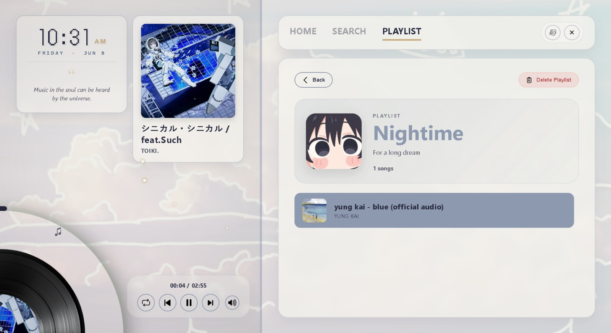

````markdown
# 🎧 Astralis Vinyl

An aesthetic, lightweight, and advanced **Cosmic Vintage** themed Desktop Music Player. Built using the power of **Tauri** (Rust + Web Frontend) for seamless YouTube integration and high performance.

<p align="center">
  <br>
  
  <br>
</p>

---

## 🚀 Key Features

Astralis Vinyl is not just a regular music player. It combines modern functionality with retro aesthetics.

### 🔭 Cosmic Integration & Performance

- **Built with Tauri:**  
  A blazing fast and secure Rust backend paired with a flexible Web frontend (HTML/CSS/JS). The application is highly lightweight and RAM-efficient.

- **YouTube Engine:**  
  Stream and search for songs directly from YouTube through an efficient Rust backend loop.

- **Local Library (Offline):**  
  Download your favorite songs permanently to your local storage directly through the app.

---

### ✨ "Cosmic Vintage" Aesthetics (UI/UX)

- **Glassmorphism Interface:**  
  Transparent frosted glass panels with dynamic background blur effects.

- **Vinyl Animation:**  
  A smoothly spinning vinyl record with the album cover right in the center, spinning synchronously with music playback.

- **SVG Progress Ring:**  
  An elegant golden circular duration indicator surrounding the vinyl.

- **Dot-Matrix LED Clock:**  
  A retro-themed digital LED station clock complete with the current day and date.

- **Dynamic Quotes Carousel:**  
  Displays random inspirational quotes about music that change every minute with smooth fade transitions.

- **Particle Effects:**
  - **Starfall Projector:**  
    Golden falling stars projecting from the "Now Playing" card while music is active.
  - **Flying Notes:**  
    Musical note symbols floating upwards from the spinning vinyl.

---

## 🎮 Advanced Media Controls

- **Vinyl Scrubbing Seek:**  
  Click and drag around the vinyl record area to seek to a specific time in the song.

- **Advanced Volume Control:**
  - **Single Click:** Toggles the volume slider popover.
  - **Double Click (Quick Tap):** Instantly mute or unmute while restoring the previous volume level automatically.
  - Dynamic volume icon updates in real time.

---

## 🛠️ Tech Stack

This application is an implementation example of the **Tauri** architecture.

### Backend (Core Logic)

- [](https://www.rust-lang.org/)
- [](https://tauri.app/)

### Frontend (UI & Interaction)

- [](https://developer.mozilla.org/en-US/docs/Web/HTML)
- [](https://developer.mozilla.org/en-US/docs/Web/CSS)
- [](https://developer.mozilla.org/en-US/docs/Web/JavaScript)

### Database

- JSON Local Storage (Managed by Rust)

---

## 📦 Running from Source (Development)

To run this project locally for development, ensure you have installed the Tauri prerequisites.

### Prerequisites

#### Node.js
Download and install from:
https://nodejs.org/

#### Rust Compiler (Cargo)

Run the following command in your terminal:

```bash
curl --proto '=https' --tlsv1.2 -sSf https://sh.rustup.rs | sh
````

---

## 🚀 Setup & Run

### 1. Clone this repository

```bash
git clone https://github.com/your-username/astralis-vinyl.git
cd astralis-vinyl
```

### 2. Install frontend dependencies

```bash
npm install
```

### 3. Run the application in development mode

```bash
npm run tauri dev
```

> Tauri will automatically download the required Rust dependencies during the first launch.

---

## ⚙️ Building for Production (.exe)

Tauri can bundle this application into a standalone installer file (`.msi` or `.exe`) ready for distribution.

### 1. Generate Custom App Icons

Ensure you have a `main.png` file inside:

```text
src/assets/main.png
```

Then run:

```bash
npm run tauri icon src/assets/main.png
```

### 2. Build the application

```bash
npm run tauri build
```

---

## 📁 Build Output

After the build process is complete, the installer can be found in:

```text
src-tauri/target/release/bundle/msi/
```

---

## 📜 License

This project is licensed under the MIT License.

See the [LICENSE](LICENSE) file for more details.

---

## 📩 Contact

Created with ❤️ by **Blueberry221**

* **Email:** [frozendsp@gmail.com](mailto:frozendsp@gmail.com)
* **GitHub:** https://github.com/Blueberry221

---

<p align="center">
  <i>"Astralis Vinyl: Lost in time, found in music."</i>
</p>
```
